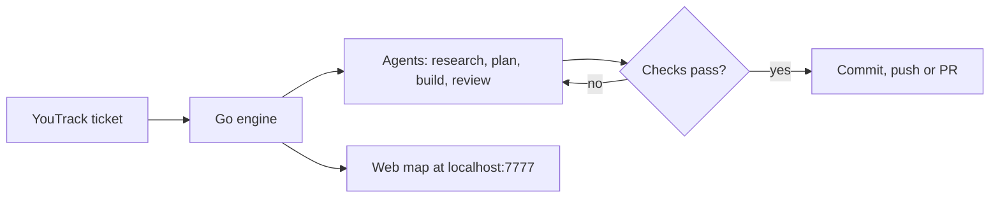

# Factory harness

Factory takes a YouTrack ticket and runs a team of headless coding agents (Pi, Claude Code, Codex) on it until the checks pass and the reviewers sign off, then commits, pushes or opens a PR.



The engine runs each job in its own git worktree. Every model call goes through a metering proxy in front of the JetBrains Central wire, so you can see cost per agent. More detail is in `docs/PRD.md` and `docs/ENGINE.md`.

## Setup

You need Go, Node, `git`, `gh` and the JetBrains Central CLI (`central`), signed in. Install whichever agent CLIs you want to use (`claude`, `codex`).

```
cd pi-host && npm install && cd ..
go run ./cmd/artbuild
go install ./cmd/factory
factory serve
```

Open http://localhost:7777 for the map and http://localhost:7777/admin.html to add your YouTrack URL and token and pick models per role.

In each repo you want Factory to work on, run `factory init`. It writes `factory.yml` and adds `.factory/` to `.gitignore`.

New task never carries the repository over from your last job. Type the ticket ID and it suggests the repositories that project's tickets ran in before; you pick one. If the ticket's project doesn't match the repo (its `factory.yml` maps another project, or the repo has only run other projects' tickets), the engine says so and waits for you to confirm. A folder that isn't a git repository yet can be made one from the form; what's in it becomes the first commit. For a repository with no remote, tick **Create a private GitHub repository for it** and pick the `gh` account: the engine creates it when the work ships, pushes there, and opens PRs as that account. A job that tries to push with no remote stops and offers the same.

To have the product agent go over a repo's board, asking owners, fixing tickets and starting jobs on the ready ones, press **🏛 Board** on the map. You can run him there or let him run on his own when something happens on the board. See `docs/TRIAGE.md`.
