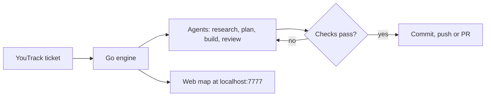

# Factory harness

Factory takes a YouTrack ticket and runs a team of headless coding agents (Pi, Claude Code, Codex) on it until the checks pass and the reviewers sign off, then commits, pushes or opens a PR.



The engine runs each job in its own git worktree. Every model call goes through a metering proxy in front of the JetBrains Central wire, so you can see cost per agent. More detail is in `docs/PRD.md` and `docs/ENGINE.md`.

## Setup

You need Go, Node, `git`, `gh` and the JetBrains Central CLI (`central`), signed in. Install whichever agent CLIs you want to use (`claude`, `codex`).

```
cd pi-host && npm install && cd ..
go run ./cmd/artbuild
go install ./cmd/factory
factory serve
```

Open http://localhost:7777 for the map and http://localhost:7777/admin.html to add your YouTrack URL and token and pick models per role.

In each repo you want Factory to work on, run `factory init`. It writes `factory.yml` and adds `.factory/` to `.gitignore`.
