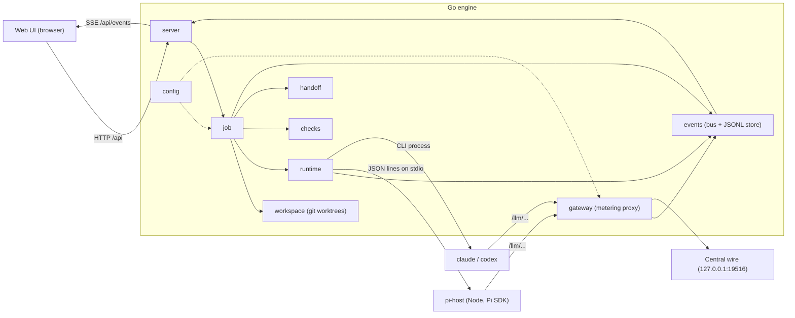
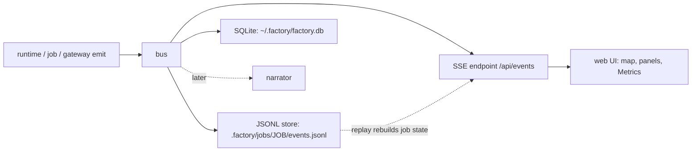
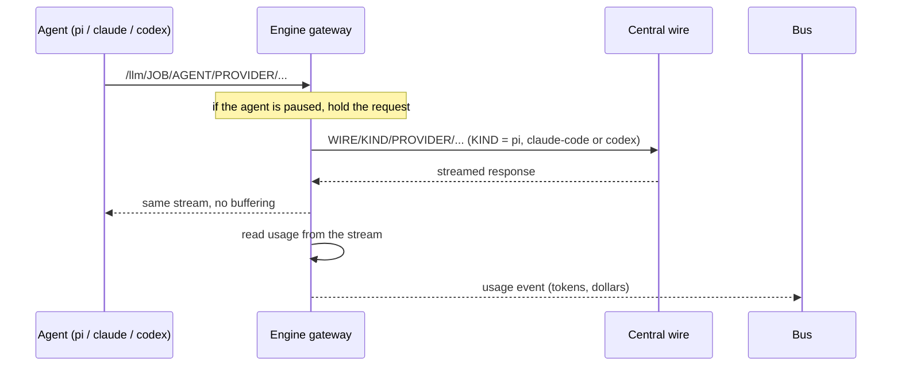
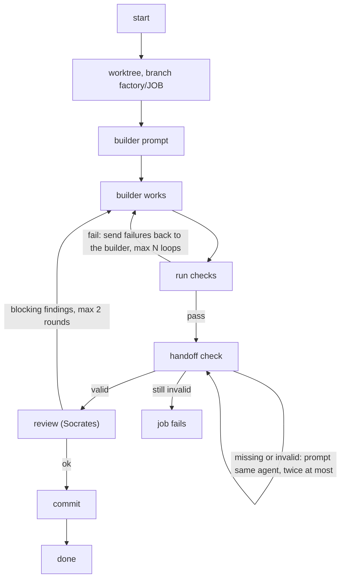

# Engine design (M0)

This file says where the Go engine's code lives and how the parts talk. What the engine does and why is in `docs/PRD.md`. Model access and cost metering are in `docs/WIRE.md`.

In short: the engine runs a job as a loop of build, check, heal and handoff inside a git worktree. Agents run as Pi, Claude Code or Codex behind one `Runtime` interface. Every action becomes an event on a bus. The events go to a per-job log and to the web UI over SSE. Every model call passes through a metering proxy.



## 1. Layout

```
cmd/factory/          CLI: factory init, factory serve
internal/
  config/             factory.yml (per repo) and ~/.factory (gateway, models)
  events/             event type, in-process bus, JSONL store per job
  workspace/          git worktrees and branches per job
  gateway/            metering proxy in front of the Central wire
  runtime/            the Runtime interface and the Pi adapter
  checks/             runs the project's check commands
  handoff/            the handoff note: schema and validation
  job/                one job's pipeline: build, check, heal, handoff, commit
  server/             HTTP API, event stream (SSE), web files
pi-host/              Node sidecar that runs Pi sessions with the Pi SDK
art/, cmd/artbuild/   the art catalogue (already built)
web/                  the web interface and generated assets
```

## 2. Events

Everything the engine does is an event. The web interface, the Chronicle and the Metrics tab only read events.



```go
type Event struct {
    Seq   int64          `json:"seq"`
    Time  time.Time      `json:"time"`
    Job   string         `json:"job"`
    Agent string         `json:"agent,omitempty"`
    Type  string         `json:"type"`  // e.g. job.started, agent.thinking, check.failed
    Data  map[string]any `json:"data,omitempty"`
}
```

Each job's events are appended to `.factory/jobs/<job>/events.jsonl`. The bus fans them out to subscribers (the SSE endpoint, the narrator later). Replaying a file rebuilds the job's state. The SQLite copy is described in §8.

## 3. Gateway (metering proxy)



The proxy reads usage from Anthropic `message_start` and `message_delta` events and from OpenAI `response.completed` events. The wire URL is found as in `docs/WIRE.md` §3.2 and can be set in `~/.factory/gateway.yml`.

## 4. Runtimes

```go
type Runtime interface {
    Start(ctx context.Context, spec AgentSpec) (Agent, error)
}

type Agent interface {
    Prompt(ctx context.Context, text string) error  // run a turn, wait until idle
    Steer(text string) error                        // your message by UFO
    Stop() error
    Events() <-chan events.Event                    // thinking, tools, text
}
```

All three runtimes work behind this interface, and each was tested live on the demo repo:

- Pi runs in the SDK sidecar and is the primary runtime.
- Claude Code runs as one headless `claude -p` process per agent, with stream-json both ways. Model traffic reaches the gateway through `--settings`, and factory tools through the engine's MCP endpoint (`/mcp/<job>/<agent>`). Your messages go in on stdin while it works.
- Codex runs as one `codex exec --json` per prompt, resuming the same session. The provider and MCP are set with `-c` for that run only. A message from you stops the run and resumes the session with it.

## 5. Pi sidecar protocol

The engine starts `node pi-host/index.mjs` once. They talk in JSON lines: requests on stdin, replies and events on stdout.

Engine to sidecar:

```json
{"id":1,"op":"start","agent":"archimedes","cwd":"/…/worktrees/ABC-1","model":"anthropic/claude-sonnet-5-5","system":"…","tools":["read","bash","edit","write","grep","find","ls"],"engine":"http://127.0.0.1:7777","job":"ABC-1"}
{"id":2,"op":"prompt","agent":"archimedes","text":"…"}
{"id":3,"op":"steer","agent":"archimedes","text":"…"}
{"id":4,"op":"stop","agent":"archimedes"}
```

Sidecar to engine:

```json
{"id":1,"ok":true}
{"event":"agent.thinking","agent":"archimedes","data":{"text":"…"}}
{"event":"agent.tool","agent":"archimedes","data":{"tool":"bash","args":{…}}}
{"id":2,"ok":true,"done":true}
```

The sidecar runs Pi with its own agent folder (`.factory/pi-agent/`), so your personal Pi extensions don't load. Its `models.json` points the `anthropic` and `openai` providers at the engine's gateway. Factory tools (`handoff`, `set_status`, `board_post`) are Pi custom tools that call the engine's HTTP API.

## 6. Job pipeline (M0)



The handoff check follows PRD §7.6, with one difference from the PRD: after two failed retries M0 fails the job instead of pausing for an Inbox card. Open questions in a note put the job in a "needs you" state instead of failing it. The agent waves on the map, your reply is added to the note, and the job continues.

The review step is described in §8. The other roles (research, planning, humanizer, finalizer, scheduler) come in M1. M0 proves the spine: worktree, Pi, gateway, checks, healing loop, handoff, events.

## 7. HTTP API (M0)

| Method | Path | What it does |
|---|---|---|
| POST | `/api/jobs` | start a job: `{repo, title, prompt, checks: ["npm test"], model}` |
| GET | `/api/jobs` | list jobs and their state |
| GET | `/api/events?job=<id>` | server-sent events, replays the job's log first |
| POST | `/api/agents/<job>/<agent>/message` | steer an agent (the UFO) |
| POST | `/api/agents/<job>/<agent>/stop` | stop an agent |
| POST | `/api/tools/<job>/<agent>/<tool>` | factory tools called from inside agents |
| any | `/llm/<job>/<agent>/<provider>/…` | the metering gateway |
| GET | `/` | the web interface |

## 8. Status

M0 runs end to end. It was tested on a throwaway repo (`/tmp/factory-demo`) with a broken `Add` function and its test, using `claude-haiku-5-5` through the Central wire:

- The worktree and branch `factory/DEMO-5` were created inside the repo's `.factory/`.
- The Pi builder started in the sidecar, read the code, fixed it and ran the tests itself.
- Every model call went through the gateway and was metered (about $0.01 for the job).
- The handoff note was checked. An earlier run had one rejected and rewritten.
- The engine's own check (`go test ./...`) passed, and the job committed one clean file.
- Every step is in `.factory/jobs/DEMO-5/events.jsonl` and on `/api/events`.

Run it:

```
cd pi-host && npm install && cd ..
go run ./cmd/factory serve
curl -X POST localhost:7777/api/jobs -d '{"repo":"/path/to/repo","title":"…","prompt":"…","checks":["go test ./..."]}'
curl -N "localhost:7777/api/events?job=<id>"
```

Since then, these parts are done.

### 8.1 Web app

- The map follows the engine. Served by `factory serve`, it loads the real jobs and follows each one's event stream. State picks the place, tool calls and status become bubbles, thinking fills the agent panel, checks colour the Oracle smoke, handoffs fly as scrolls, usage adds to the dollar counters, processes fill the Processes panel, and a commit sails the ship. New task starts a job, and the UFO sends a real steer. Served any other way, the page keeps the demo.
- `http://127.0.0.1:7777/` opens the app, live only with no demo. The art preview with the demo stays at `/assets/preview.html`.
- New task takes an issue ID and optional notes. With YouTrack set up (Admin → Connections), the engine loads the issue's title and description and adds your notes. Without it, the notes are the task. Running the same ticket again gets `-run2`, `-run3`.
- Shipping follows the ticket's "Ship mode" field in YouTrack: Commit, Push or PR. The engine reads it when each job starts, so a change applies to the next job without a restart. When the ticket leaves it empty, `ship` in `factory.yml` decides, and the default is `commit`. Agents never commit themselves: the builder is told not to, and any commit it makes on the job branch is undone (`ship.uncommitted`) before the engine makes its own. Push goes to `origin`, and the PR is opened with `gh`, from the builder's handoff and the reviewer's summary. The PR's URL is saved on the job row in the database (`pr_url`), so Admin → Jobs links each job to its PR, even after a restart.
- Admin opens over the map (the Admin button or the A key) and starts on a Jobs tab. It lists every job with its state (running and in which phase, waiting on you with the question and an answer box, done with branch, commit and pull request, failed with the error), cost, time, runtime and model, and buttons to show it on the map or stop it. It refreshes every 3 seconds.
- The admin panel at `/admin.html` has these pages: Connections (wire status, Central version, credits, YouTrack URL and token), Runtimes (installed versions), Models (read live from the wire), Roles (runtime and model per role, only valid pairs, used by builders now), Metrics (spend, requests, tokens, cost by model and agent, time per phase, tool calls, who talks to whom, checks, jobs) and Limits (off by default). Settings are stored in `~/.factory/settings.json`.
- Fonts are served by the engine (`web/fonts/`), so the app loads instantly and works offline.
- The Aegean groups jobs by project. Each project (repo) holds a country of three islands, with a dashed border and a plaque showing the project, its jobs and its cost. A new job takes a free island in its project's country, or the place of that project's oldest finished job. Only when every island there is busy does the project spread to a free country. Boats follow sea routes found on the map's water pixels, so they never cross land.
- Homer, the top panel and the city cards start folded. Click Homer's portrait to open him, and the minus button to fold him again. The ▾ on the top panel shows the details. City cards show the full ticket on hover.

### 8.2 Checks, prompts and skills

- How to test is free text in New task. The builder first turns it into commands with the `set_checks` tool (a Pi tool and an MCP tool). The engine runs those commands and decides. Without notes, the repo's saved check plan is used.
- Role prompts live in `internal/prompts/roles/<role>.md`, built into the engine. Edits made in Admin → Prompts are saved in `~/.factory/prompts/<role>.md` and win. Each runtime gets the prompt differently: Pi adds it to its system prompt (`appendSystemPrompt`), Claude Code uses `--append-system-prompt`, and Codex gets it in front of the first message.
- Skills from mattpocock/skills are kept in `~/.factory/skills/mattpocock`. Admin → Skills downloads or updates them and sets which role gets which skill. Pi loads them with `additionalSkillPaths`. Claude Code gets a per-role plugin in `~/.factory/skillsets/<role>` via `--plugin-dir`. Codex gets a list of SKILL.md paths in front of its first message. Pi also loads the global humanizer skill in `~/.agents/skills`.
- Admin → Skills shows only the skills some role uses. The rest are in an "Add a skill" picker.

### 8.3 Reviewer

After the checks pass and the builder's handoff is accepted, Socrates gets the task, the handoff note, the diff and the checks. His role is reviewer, with runtime and model from Admin → Roles and the skills code-review and grilling. He grills the builder with `ask_builder`: one question at a time, at most 4 per round. The engine passes each question to the builder's session and returns the answer. He ends with `verdict`. Blocking findings go back to the builder, the checks run again, and he reviews again, at most 2 rounds. On the map, both stand at the Areopagus and talk in speech bubbles.

### 8.4 Storage and prices

- SQLite (`~/.factory/factory.db`, pure-Go driver, no C compiler) has the tables `jobs`, `events` and `prices`. `events` holds every event and is the engine's source for replay and metrics. Sequence numbers come from here. Each job's `events.jsonl` in its repo stays as a readable copy. The old `jobs.json` is imported once.
- Prices come from models.dev (LiteLLM's list as fallback) on start and once a day. Admin → Prices shows them, updates on demand and lets you set one by hand, which is kept across syncs. Every price change recalculates past costs.

### 8.5 Symposium

The code is in `internal/job/symposium.go`. The rules and scoring are in PRD §7.3 and D27. This is what the code does:

- It opens when the job is marked complex in New task, when your notes ask for it ("this one is complex, use hypothesizing"), when the builder calls `propose_experiments`, or when the same check keeps failing.
- Aristotle (planner) proposes 2 to 4 experiments. Each gets its own builder, worktree and `exp/<job>/<n>` branch, and they run in parallel.
- Zeno (grader) grades them blind as A, B, C. The score is 0.6 × pass rate + 0.4 × (grade − 1)/4.
- The winner is fast-forwarded into the job branch, then reviewed and committed as usual.
- Every experiment is archived in `.factory/jobs/<job>/symposium/exp-N-<name>/`.
- An experiment is out if a check fails, it changes the project's existing tests, or it changes nothing. New test files are removed and the builder is told, but that alone doesn't put it out.

Tested live as DEMO-14 (ParseDuration, all Haiku). Three experiments (hand scanner, regexp, split and table) all passed. The regexp one won with 0.9 and was reviewed, merged and committed for about $0.02.

## 9. Where data lives

| What | Where |
|---|---|
| Jobs, every event, prices | `~/.factory/factory.db` (SQLite) |
| Settings: wire, roles, skills per role, YouTrack, limits | `~/.factory/settings.json` |
| Your edits to role prompts | `~/.factory/prompts/<role>.md` |
| Skills repo copy, per-role Claude plugins | `~/.factory/skills/`, `~/.factory/skillsets/` |
| Pi's own config for factory agents | `~/.factory/pi-agent/` |
| Per job, inside the repo (git-ignored) | `.factory/jobs/<job>/` (events.jsonl, handoff notes, scratch) and `.factory/worktrees/<job>/` |

The planned layout of `.factory/` is in PRD §10.6.

## 10. Next steps

1. ~~Wire the web map to `/api/events`.~~ Done.
2. ~~Claude Code and Codex runtimes.~~ Done.
3. The other roles: survey and check plan, research, planner, humanizer, finalizer, scheduler (the reviewer is done).
4. YouTrack: load a ticket by ID, comment and move it to review.
5. ~~Ship modes push and PR.~~ Done.
